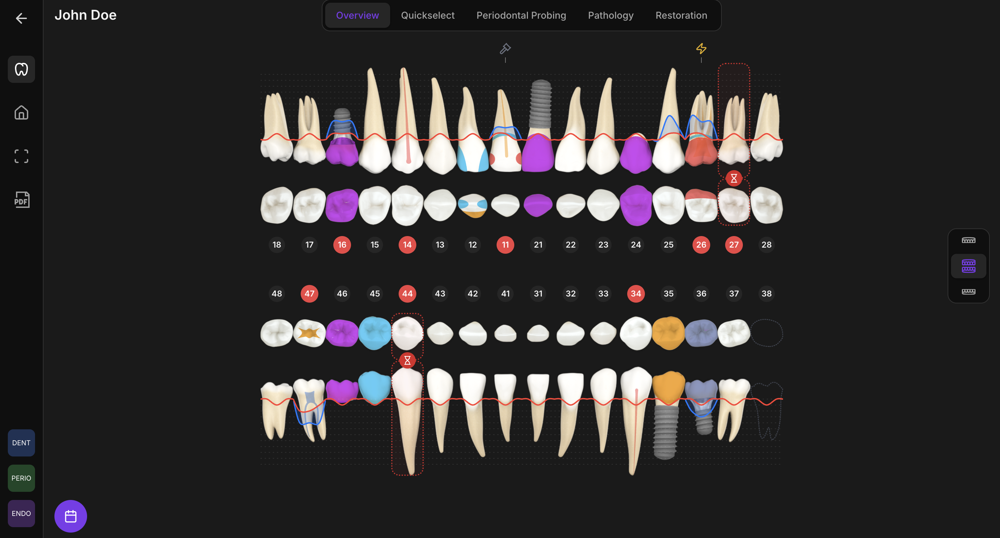

# 🦷 Dental Chart — Digital Dental Application

A web application for dental practices: patient records, treatment planning and a
3-plane tooth chart built on **ISO 3950** numbering. The chart is a projection of
completed history and the treatment plan.



## Architecture

```
Browser                                Backend
┌────────────────────────┐             ┌────────────────────────────────────────┐
│ Pages                  │             │ routes → http → application → domain   │
│   ↓                    │   REST      │                     ↑                  │
│ AppFacade → apiClient  │ ⇄  /api     │              infrastructure            │
│   ↓                    │             │       DynamoDB · email · Modal AI      │
│ Zustand + adapters     │             └────────────────────────────────────────┘
└────────────────────────┘
```

The backend is a modular monolith: each bounded context owns its `domain`,
`application`, `infrastructure` and `http` layers, and one composition root wires
them together. Dependency rules, the error model and the host adapters are documented
in [docs/backend-architecture.md](./docs/backend-architecture.md).

| Module | Responsibility |
| --- | --- |
| `identity` | accounts, login, sessions, API keys, Google sign-in, password recovery |
| `clinic` | workspaces, memberships, invitations, ownership |
| `patients` | patient records, history, treatment plan |
| `integration` | external API-key patient contract |
| `ai` | X-ray inference and fallback detections |
| `analytics`, `email` | product telemetry, transactional email |

One route table (`apps/backend/src/routes/definitions.js`) serves every host: the local/VPS
Express process, AWS Lambda and the Cloudflare Worker. Data lives in a single document
table using `PK`/`SK` keys: DynamoDB by default, or PostgreSQL with `DB_DRIVER=postgres`
(see [docs/postgres-setup.md](./docs/postgres-setup.md)).

### Technology stack

| Area | Technology |
| --- | --- |
| Frontend | React 19, Vite 7, Zustand, React Router |
| Styling | Vanilla CSS with CSS variables |
| Backend | Node.js 22, Express 5 |
| Hosts | Express (VPS), AWS Lambda, Cloudflare Workers |
| Data | Amazon DynamoDB (single table) |
| AI | Modal: YOLO11-seg + ResNet18 |

## Features

- Patient CRUD with search, treatment plan and chronological history.
- Chart views: Overview, Quickselect, Periodontal probing, Pathology, Restoration.
- Tooth detail in frontal, occlusal and lingual planes, with endodontic, periodontal,
  pathology and restoration tabs.
- Oral health metrics, BPE, medical issues and patient reports.
- Google sign-in, refresh-token sessions, account API keys and an external API contract.
- Panoramic X-ray analysis with a static fallback when the model is unavailable.

## AI analysis

`apps/backend/src/modules/ai` calls a Modal endpoint that segments every tooth (YOLO11-seg,
FDI/ISO 3950 classes) and classifies each masked crop (ResNet18: sound, filling, root
canal, crown, caries, residual root, root canal + crown). When the endpoint is disabled
or unreachable, the API serves `/static/detections.json` and a sample image from the
build.

| Step | Command |
| --- | --- |
| Prepare the dataset | `modal run apps/ml/models/data_preparation.py` |
| Train segmentation | `modal run apps/ml/models/train.py` |
| Train the status classifier | `modal run apps/ml/models/train_status.py` |
| Resume classifier training | `modal run apps/ml/models/train_status.py --resume true` |
| Deploy the inference endpoint | `modal deploy apps/ml/models/inference.py` |

## Project structure

```
├── apps/
│   ├── backend/   API modular monolith — see docs/backend-architecture.md
│   │   ├── app.js Express host (local and VPS)
│   │   ├── lambda.js AWS Lambda host
│   │   └── src/   container.js, modules/, shared/, http/, routes/
│   ├── frontend/  React app: pages, components, domain adapters, Zustand store
│   └── ml/        Modal training and inference pipeline
├── worker/        Cloudflare Worker entry point and Wrangler config
├── deploy/        SAM template, VPS release assets and generated artifacts
├── scripts/       build and deploy automation
├── k8s/           Kubernetes manifests
└── docs/          architecture map, serverless and VPS deployment guides
```

## API

The API is documented with OpenAPI in [apps/backend/docs/openapi.yaml](./apps/backend/docs/openapi.yaml)
and served at `/docs` when the app runs. Main groups:

- `/api/auth` — register, login, Google, refresh, logout, password recovery.
- `/api/medics`, `/api/clinics` — profile, API key rotation, workspaces, members.
- `/api/patients` — records, chart, history, treatment plans.
- `/api/ai` — X-ray analysis and fallback assets.
- `/api/external` — API-key authenticated patient upsert and delete.

## Getting started

Prerequisites: Node.js 22+ and a DynamoDB table with `PK`/`SK` keys (see
[docs/dynamodb-setup.md](./docs/dynamodb-setup.md)).

```bash
npm install --prefix apps/frontend
npm install --prefix apps/backend

npm run dev                   # frontend (Vite), from the repo root
npm run dev --prefix apps/backend  # API (nodemon)
```

Configuration: copy [apps/frontend/.env.example](./apps/frontend/.env.example) for the frontend
and [apps/backend/.env.example](./apps/backend/.env.example) for the API. Deploy targets read
[.env.deploy.example](./.env.deploy.example).

```bash
npm test                    # frontend tests (Vitest)
npm test --prefix apps/backend   # backend tests (Jest)
npm run ci                  # frontend tests, frontend build, backend tests
```

## Deployment

| Target | Command | Guide |
| --- | --- | --- |
| VPS (Nginx + PM2) | `npm run deploy:backend` | [docs/deployment-automation.md](./docs/deployment-automation.md) |
| AWS Lambda (SAM) | `npm run deploy:lambda` | [docs/serverless-deployment.md](./docs/serverless-deployment.md) |
| Cloudflare Worker | `npm run deploy:worker` | [docs/serverless-deployment.md](./docs/serverless-deployment.md) |
| Cloudflare Pages | `npm run deploy:frontend` | [docs/deployment-automation.md](./docs/deployment-automation.md) |
| Kubernetes | `.github/workflows/deploy-k8s.yml` | [k8s/](./k8s/) |

Both serverless targets ship the frontend and the API as one artifact. Validate without
uploading:

```bash
npm run deploy:lambda -- --dry-run
npm run deploy:worker -- --dry-run
```

`npm run ci` runs the full local gate: frontend tests, frontend build and backend
tests. The Lambda and Worker workflows run the same checks before deploying. Before
changing deployment code, read
[docs/serverless-deployment.md](./docs/serverless-deployment.md); it covers the asset
split, secrets, cache rules, rollback and known limits.

## Documentation

| Document | Contents |
| --- | --- |
| [docs/backend-architecture.md](./docs/backend-architecture.md) | backend modules, layers, composition root, error model |
| [docs/architecture-map.md](./docs/architecture-map.md) | navigable mindmap of frontend and backend |
| [docs/serverless-deployment.md](./docs/serverless-deployment.md) | Lambda and Worker deployment, assets, secrets |
| [docs/deployment-automation.md](./docs/deployment-automation.md) | CI, VPS release flow, Cloudflare Pages |
| [docs/postgres-setup.md](./docs/postgres-setup.md) | running the API on PostgreSQL instead of DynamoDB |
| [docs/vps-setup.md](./docs/vps-setup.md) | step-by-step VPS setup |
| [apps/ml/README.md](./apps/ml/README.md) | training pipeline, dataset and Modal commands |
| [apps/backend/docs/openapi.yaml](./apps/backend/docs/openapi.yaml) | API contract |

---

**Version**: 1.0.0-beta
**Last updated**: October 2026
